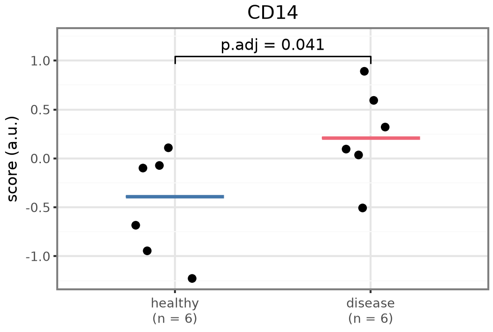
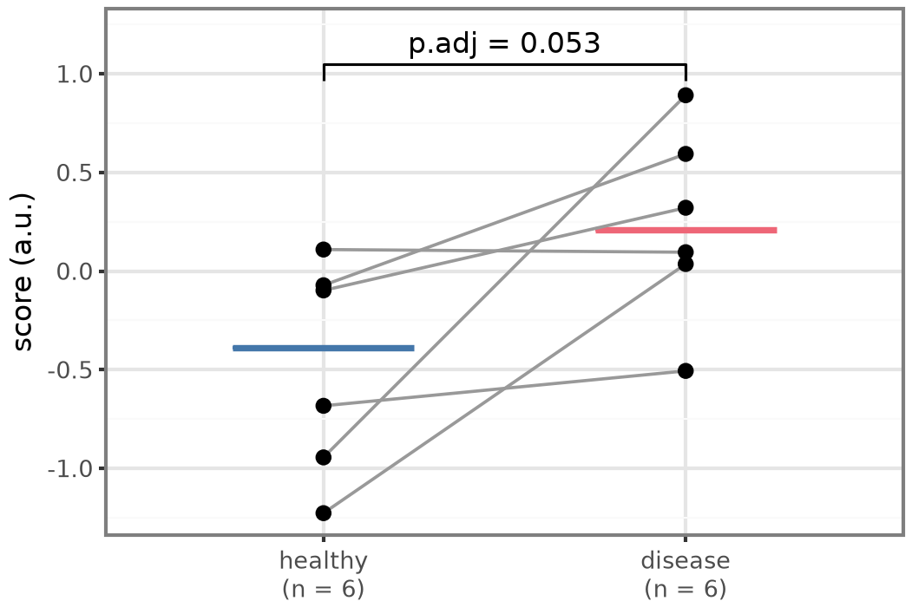
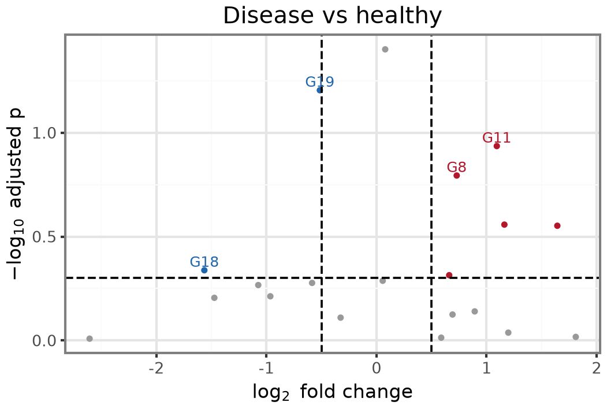
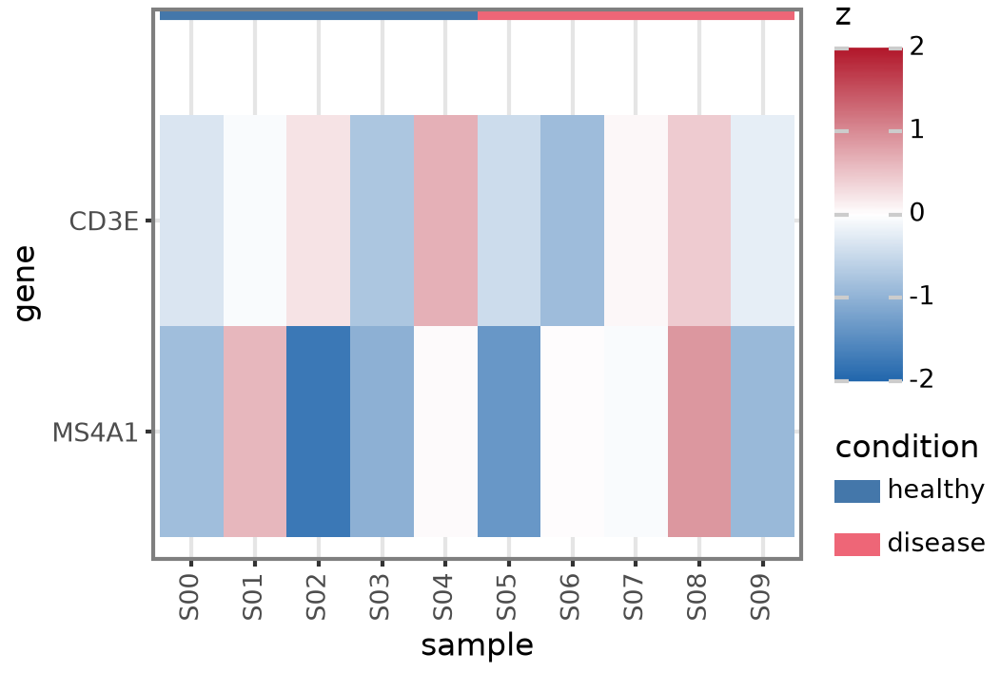
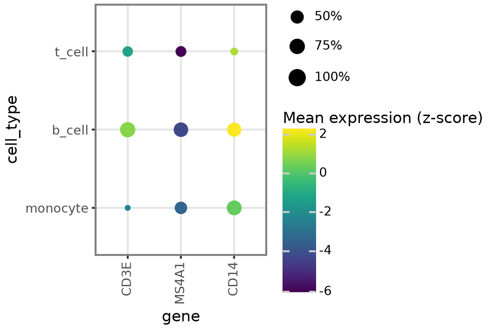
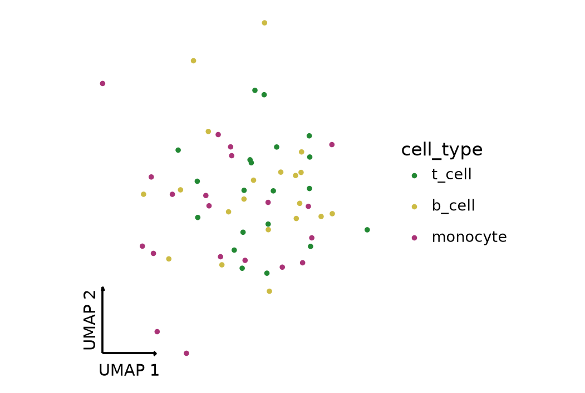
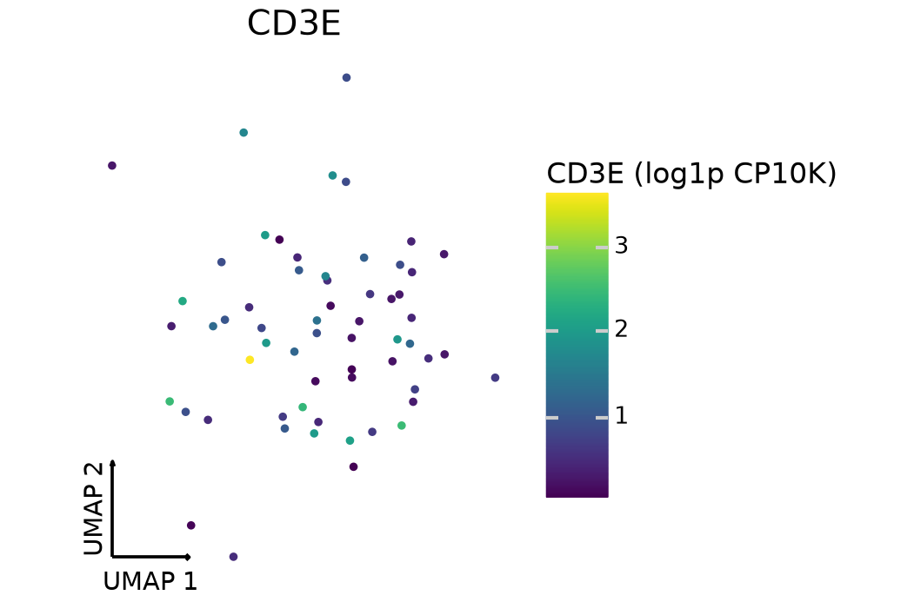
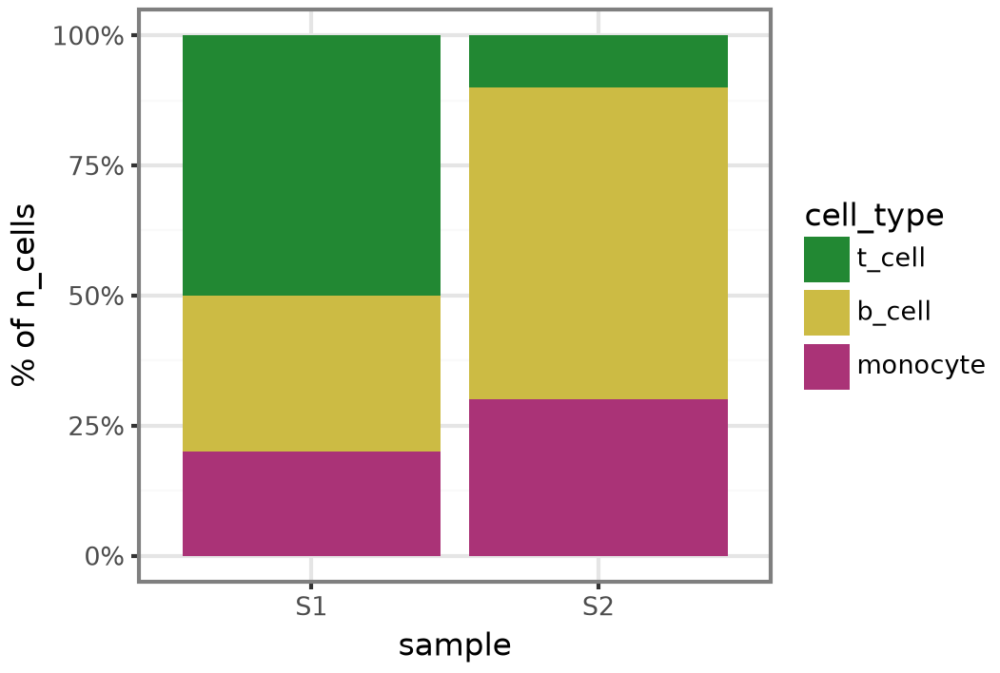

The `figure-style` skill gives every scientific figure one look, in R (ggplot2,
ComplexHeatmap) and in Python (plotnine with
[plotnine-extra](https://mdmanurung.github.io/plotnine-extra/)). It applies
to plot types it has never seen, because it states principles first and forms
second. It takes precedence over generic charting skills for figures drawn
from experimental, omics or single-cell data.

## Principles

1. **Name it, then explain it below.** One short title; no subtitle; the caption goes in the report, at most 60 words.
2. **Show the unit of replication.** Each donor is a point; n sits under each group label.
3. **Make inference visible and honest.** Brackets show the adjusted p; the test and adjustment come from the analysis plan.
4. **Colour has one job.** Label-keyed palettes, viridis for continuous values, blue-white-red centred at 0, blue down and red up.
5. **Encode groups twice.** Colour plus shape or position, so the figure survives greyscale.
6. **Axes carry meaning.** Units on every axis; log₂ typeset; embeddings without frame, with corner arrows.
7. **Order is information.** Natural orders stay; a heatmap states its order basis.
8. **Mark the design.** Dashed thresholds; pair lines only for paired data; annotation bars on heatmaps.
9. **Distributions match their size.** Under 10 points: points and a median. More: violin or box under points.
10. **Missing is not zero.** "Not tested" gets its own mark.
11. **One build, three files.** `cairo_pdf`, a PNG for review, and the source-data CSV.

The full text, with worked examples for Kaplan–Meier, correlation matrices,
ridgelines, spatial maps and GSEA curves, is in
[`skills/figure-style/SKILL.md`](https://github.com/mdmanurung/lucid-coder/blob/main/skills/figure-style/SKILL.md).

## Gallery

These come from the Python templates' self-check on toy data. The R templates
draw the same forms.

::: {layout-ncol=2}















:::

## Templates

Copy `templates/theme.*`, `palettes.*` and `plots.*` into a project and source
or import them. Every function returns a ggplot object, in either language.

| Function | Form |
|---|---|
| `plot_box(..., test=, p_adjust=, pair=)` | Points per group with brackets; paired with `pair=` |
| `plot_violin` | Violin with a median line |
| `plot_volcano(..., n_label=)` | Volcano with dashed cut-offs |
| `plot_heatmap(..., col_annotation=)` | Diverging heatmap with symmetric limits |
| `plot_dotplot(..., mean_label=)` | Marker dot plot |
| `plot_embedding(..., axis_name=)` | UMAP or PCA by label |
| `plot_feature` | One value on an embedding |
| `plot_composition` | Stacked proportions per sample |
| `plot_scatter_fit` | Scatter with a fitted line |
| `save_panel(plot, data, run_dir, name, width_mm, height_mm)` | Writes PDF, PNG and CSV |

```python
from palettes import pal_condition
from plots import plot_box
from theme import save_panel

p = plot_box(
    donors, "condition", "score", pal_condition,
    jitter_width=0.2, seed=1, value_label="ISG score (a.u.)",
    test="wilcox.test", p_adjust="BH", title="ISG15 in CD14+ monocytes",
)
save_panel(p, donors, "results/run_01", "fig2c-isg-score", 89, 60)
```

The test and the adjustment have no default: pass both or neither.
